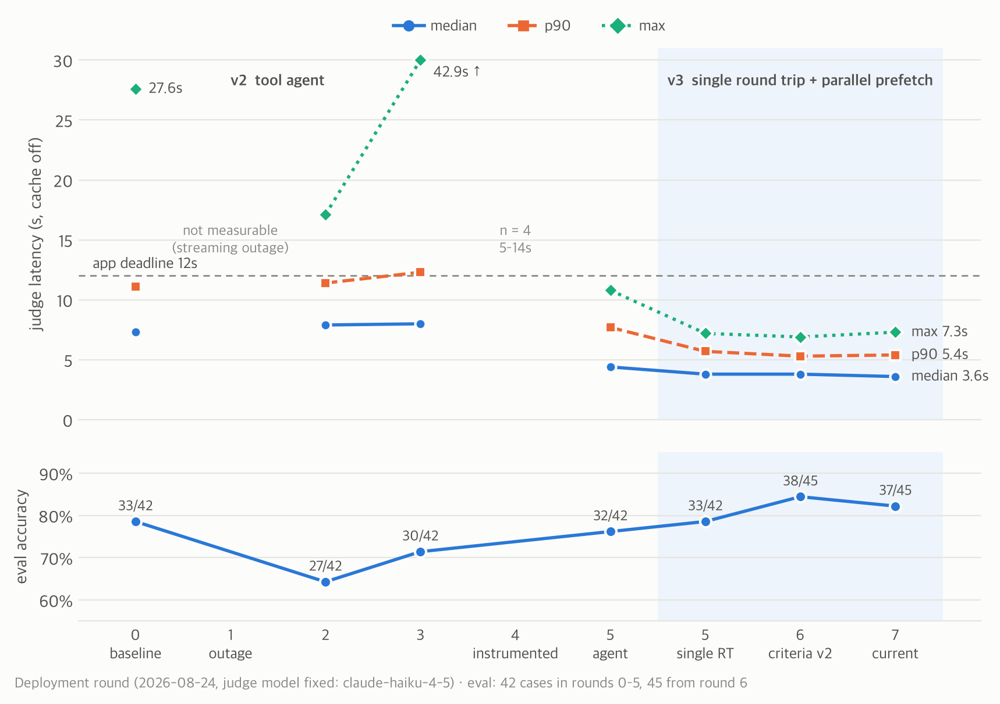

# guadian

<picture>
  <source media="(prefers-color-scheme: dark)" srcset="docs/images/deploy-latency-dark.png">
  
</picture>

guadian is a service for seniors that prevents digital harm originating from malicious ads. On Android, it outlines ads on screen and, when an ad is tapped, **blocks the landing page before it opens** if the destination is dangerous. At tap time the app sends the destination URL to a judge server, which returns one of `LOW` (pass), `MEDIUM` (confirm), or `HIGH` (block). The app's response deadline is **12s**.

The core of this repo is optimizing that judge server. With the judge model ([`claude-haiku-4-5`](server/main.py#L408)) held fixed, we redesigned the judging architecture **v1 → v2 → v3** and tuned timeouts and I/O paths over seven deployments. Median judge latency dropped from **7.3s → 3.6s**, max latency from **27.6s → 7.3s**, judgments exceeding the 12s app deadline from **6/72 → 0/45**, and accuracy rose from **79% → 82%**.

> The gains came from two axes, not from swapping models: **when and how the context passed to the LLM is assembled** (architecture), and **latency sources along the request path** (timeouts, I/O). Every number is measured with caching disabled (`--fresh`) on the same eval set, and each one is sourced in [docs/history.md](docs/history.md).

## Judging architecture: v1 → v2 → v3

| Version | Approach | Limitation (measured) | Outcome |
| :-- | :-- | :-- | :-- |
| v1 Fixed pipeline ([`main._ask_llm`](server/main.py#L1221)) | One code-defined sequence: fetch the page once → call the LLM once | Ends as "unverifiable" when the body is empty (JS rendering, intermediate redirect pages). Text signals alone cannot detect impersonation, e.g. `kb-star.top` displaying "KB Kookmin Bank" | Dropped |
| v2 Tool agent | The LLM decides which tools to call, how many, and in what order. Code enforces only a budget (3 tool calls, 7.5s), evidence grounding, and the output schema | 72 live requests (2026-08-23): **46% needed 2+ round trips**. Most extra tool calls (`page_signals`, `domain_age`, `official_domain_of`) were deterministic lookups that could be prefetched | Kept for A/B comparison and fallback (`JUDGE_ONESHOT=0`) |
| v3 Single round trip + parallel prefetch | Page body, page signals, blocklist, prior verdict, official domain, and domain registration date are collected in parallel within a 4.5s budget and included in the first prompt. One LLM call | 42-case eval, cache disabled: agent 32/42, median 4.4s, p90 7.7s ↔ single round trip **33/42, 3.8s, 5.7s** | **Adopted (current)** |

The design principle behind v2 → v3: **anything that can be looked up deterministically is prefetched, not requested through an LLM tool call.** Every tool v2's LLM requested in a second round trip returned a value the server could have obtained in advance, and that one extra round trip pushed tail latency past the app deadline (measured: `hi.co.kr` at 9.6s, [judge_agent.py#L746-L753](server/judge_agent.py#L746-L753)).

```text
v2  url ─► LLM ─► tool ─► LLM ─► tool ─► LLM ─► verdict              (1–4 round trips, sequential)

v3  url ─┬─ page body ─────────┐
         ├─ page signals ──────┤
         ├─ blocklist ─────────┤  parallel, budget ≤ 4.5s
         ├─ prior verdict ─────┼─► LLM ─► _ground ─► verdict           (1 round trip)
         ├─ official domain ───┤
         └─ registration date ─┘
```

- Implementation: prefetch [`_prefetch`](server/judge_agent.py#L713), single-round-trip prompt [`ONESHOT_RULES`](server/judge_agent.py#L654), mode switch [`JUDGE_ONESHOT`](server/main.py#L415-L416)
- **The LLM decides; code constrains.** This separation survived the architecture change. Evidence grounding (`_ground`), which downgrades a `HIGH` verdict to `MEDIUM` when its evidence is absent from the raw tool output, and output-schema enforcement both still apply in v3.
- **Isolated effect of the architecture change.** In round 5 we toggled only `JUDGE_ONESHOT` on the same server and the same eval set: median 4.4s → 3.8s (−14%), p90 7.7s → 5.7s (−26%).

## Seven deployments

We deployed seven times on 2026-08-24, measuring each round with caching disabled. Rounds 1–3 tuned timeouts without instrumentation and **regressed**; only after per-stage latency instrumentation was added in round 4 did the bottleneck become visible. Regressed rounds are kept in the record.

| Round | Change | Correct | Median | p90 | Max | > 12s | Failures | Assessment |
| :-- | :-- | :-: | :-: | :-: | :-: | :-: | :-- | :-- |
| 0 Baseline | — | 33/42 (79%) | 7.3s | 11.1s | 27.6s | 6/72 | — | Baseline |
| 1 | Global deadline, single-round-trip flag, streaming early notice | Not measurable | — | — | — | — | Streaming request hung 32s | Outage: every app verdict `UNKNOWN` |
| 2 | Streaming disabled, fallback path, connection reuse | 27/42 | 7.9s | 11.4s | 17.1s | 1 | `UNKNOWN` 9 | Tail improved; 4s LLM timeout too short, accuracy dropped |
| 3 | 1 retry, 3s per attempt, call timing logged | 30/42 | 8.0s | 12.3s | 42.9s | 7 | `UNKNOWN` 4, timeout 3 | 3s timeout < 3.4s verdict generation → regression |
| 4 | Judge call ≥ 4s, shorter output, per-stage ms in `/recent` | (n = 4) | 5–14s | — | — | — | — | Per-stage instrumentation → **~3s uninstrumented stage found** |
| 5 Agent | Removed 260k-row scan, lxml, one-time DB schema init | 32/42 | 4.4s | 7.7s | 10.8s | 0 | `UNKNOWN` 3 | −40% latency vs. baseline, −1 correct |
| 5 Single round trip | `JUDGE_ONESHOT=1` | 33/42 (79%) | 3.8s | 5.7s | 7.2s | 0 | `UNKNOWN` 1 | Adopted |
| 6 | Judging criteria v2, eval 42 → 45 cases | 38/45 (84%) | 3.8s | 5.3s | 6.9s | 0 | `UNKNOWN` 1 | Adopted |
| 7 | Blocklist DB split, corruption self-recovery, pinned dependencies | **37/45 (82%)** | **3.6s** | **5.4s** | **7.3s** | **0** | `UNKNOWN` 1 | **Adopted, current.** 38 → 37 is a one-case swing from nondeterministic page fetches |

> Rounds 0–5 use 42 cases; from round 6 on, 45 (three login/sign-up cases added), so the denominators differ. Round 0's `6/72` is based on 72 live judgments, not the eval set.

### Operating principles from the rounds

- **Set timeouts from the measured latency distribution.** Lowering the LLM timeout to 3–4s in rounds 1–3 cut off verdict generation (2.5–3.5s) and dropped accuracy to 27/42. The floor was fixed at 4s based on measured latencies ([judge_agent.py#L50-L52](server/judge_agent.py#L50-L52)).
- **Instrument per stage before optimizing.** Logging per-stage latency (ms) in `/recent` in round 4 exposed a 260k-row `SELECT DISTINCT` (~3s) running on every request. The blocklist source is now held in memory and swapped only on refresh ([main.py#L216-L220](server/main.py#L216-L220)).
- **Disable paths with an unconfirmed root cause by default, and keep a fallback.** Streaming calls intermittently timed out before receiving response headers, ending as `UNKNOWN`. Until the root cause (outbound connections) is confirmed, streaming is off by default; when enabled, a failure falls back to a regular call automatically ([main.py#L417-L420](server/main.py#L417-L420)).

Other latency improvements: a 3.5s timeout summed across redirect hops with a 300KB response cap (the cause of `chosun.com` at 27.6s), HTML parser `html.parser` → `lxml` (3–5× faster), RDAP lookups moved to the background, SDK retries 2 → 0, and an output cap of `MAX_TOKENS=450`. The full list is in [docs/history.md §03](docs/history.md#03-판정-속도-차수별-기록).

## Quick start

```bash
# Judge server
cd server && pip install -r requirements.txt
export ANTHROPIC_API_KEY=sk-ant-...
python -m uvicorn main:app --host 0.0.0.0 --port 8000

# Reproduce the table above (cache disabled)
python eval.py --server http://127.0.0.1:8000 --fresh --stream
```

```bash
# Android app (requires app/google-services.json; after install, enable Settings > Accessibility > GuADian)
./gradlew assembleDebug && adb install -r app/build/outputs/apk/debug/app-debug.apk
```

The figure at the top is regenerated with `python scripts/make_figures.py`.

**Docs** [History](docs/history.md) · [Judging criteria](docs/judge.md) · [Risk-grade rationale](docs/risk-grade-rationale.md) · [Validation](docs/risk-grade-validation.md) · [Deployment](docs/deploy.md) · [Feature spec](docs/spec.md)
